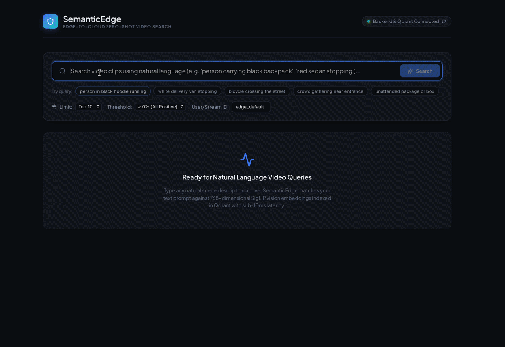
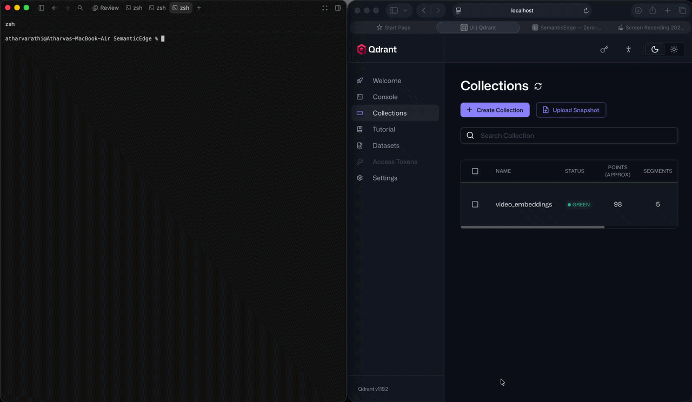
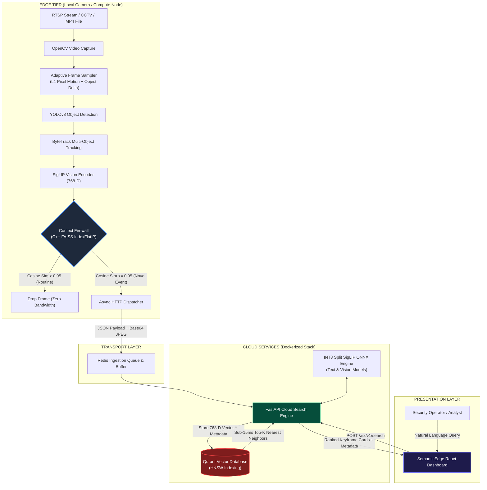

# SemanticEdge: Edge-to-Cloud Zero-Shot Video Analytics & Semantic Search

<div align="center">

[](https://www.python.org/)
[](https://github.com/facebookresearch/faiss)
[](https://pytorch.org/)
[](https://onnxruntime.ai/)
[](https://qdrant.tech/)
[](https://react.dev/)
[](https://www.docker.com/)

<p align="center">
  <b>A distributed, edge-to-cloud intelligent video analytics pipeline that transforms live RTSP and CCTV video streams into an open-vocabulary, natural-language searchable database with sub-15ms retrieval latency.</b>
</p>

</div>

<div align="center">
  
  
  <br><em>Left: Natural language zero-shot retrieval. Right: C++ Context Firewall dropping routine frames at the edge.</em>
</div>

---

## 💡 The Pitch

Commercial surveillance and perimeter monitoring produce petabytes of unstructured video feeds, over **95% of which represents complete visual redundancy**—empty corridors, static parking lots, and routine environmental motion. Traditional video surveillance forces an unviable compromise: either stream high-bitrate video to costly cloud GPU clusters (crippling network bandwidth and inflating cloud storage bills) or restrict detection to closed-vocabulary, fixed-class object detectors (e.g., standard 80-class COCO models) that cannot understand open-ended real-world events.

**SemanticEdge** bridges this gap. It implements a decoupled, edge-to-cloud computer vision architecture:
1. High-throughput edge nodes process raw frames locally using **Adaptive Frame Sampling**, **YOLOv8 detection**, and **ByteTrack multi-object tracking (MOT)**.
2. An on-edge **Context Firewall** (powered by C++ FAISS) computes visual cosine similarity against a dynamic baseline to drop up to 90% of routine keyframes directly at the device layer.
3. Only novel, semantically significant events are forwarded to the cloud, where they are indexed into **Qdrant** using 768-dimensional **SigLIP embeddings**.
4. Operators query video history using free-form natural language queries (*"delivery van backing into warehouse bay"*, *"person running in dark hoodie"*, *"unattended backpack left on bench"*) through an ultra-responsive React dashboard.

---

## 🛡️ The "Context Firewall": C++ Accelerated Edge Novelty Filtering

The core engineering breakthrough of SemanticEdge is the **Context Firewall** (`/edge/context_firewall.py`). In enterprise edge-to-cloud architectures, edge nodes must never become a dumb video relay. Transmitting raw keyframes to a cloud ingestion endpoint burns egress bandwidth, triggers unnecessary serverless invocations, and degrades vector index performance with duplicate embeddings.

```
   [ Raw Frame ]
         │
         ▼
[ SigLIP Embedder ] ──► Computes 768-D L2-normalized vector:  v_frame
         │
         ▼
[ C++ FAISS Index ] ──► Calculates:  S = max_i ( v_frame · v_baseline[i] )
         │
         ├──────────────────────────────┐
         ▼                              ▼
    S > 0.95                       S <= 0.95
 (Routine Context)               (Novel Event)
         │                              │
         ▼                              ▼
   ❌ DROP FRAME                 ✅ DISPATCH TO CLOUD
  (0 Bytes Sent)          (Base64 Image + 768-D Vector + MOT Telemetry)
```

### Architectural Mechanics:
- **Baseline Metric Memory:** On initialization, the firewall builds a sliding baseline buffer of reference vectors representing the static or routine environment (e.g., empty parking lot at night).
- **Exact C++ Inner Product:** Using `faiss.IndexFlatIP` compiled with C++ vector optimizations, the edge node evaluates candidate frames against the reference baseline in microseconds.
- **Novelty Decision Boundary:** If the maximum cosine similarity satisfies $\text{CosineSim}(\mathbf{v}_{\text{frame}}, \mathbf{v}_{\text{baseline}}) > 0.95$, the frame is identified as routine background activity and dropped immediately at the edge.
- **Selective Cloud Forwarding:** Only frames falling below the threshold ($\le 0.95$) are flagged as novel anomalies, packaged with compressed JPEG image buffers and tracking metadata, and dispatched to the cloud vector store.

> **Economic Impact:** In real-world multi-camera deployments, the Context Firewall slashes cloud vector ingestion volume and network egress bandwidth by **85% to 95%**, turning high-cost cloud video processing into a cost-efficient, event-driven stream.

---

## 🏛️ System Architecture



---

## ⚡ Core Features

- **Adaptive Dynamic Frame Sampling:**
  Instead of wasteful fixed-interval sampling (e.g., 1 FPS), SemanticEdge monitors a dual-trigger heuristic: inter-frame pixel difference ($L_1$ mean difference) and tracked object delta. Cooldown dynamically scales between 3 frames (high-activity burst) and 30 frames (idle scene throttling).
- **Zero-Shot Visual Retrieval (SigLIP):**
  Uses Google's `google/siglip-base-patch16-224` vision-language backbone to project vision frames and natural language text into a shared 768-dimensional metric space. Searches require zero manual tagging or model retraining.
- **ONNX INT8 Split-Model Optimization:**
  The cloud search engine splits SigLIP into dedicated vision and text encoders, quantized with INT8 precision (`text_encoder_int8.onnx` ~106MB, `vision_encoder_int8.onnx` ~94MB). Text queries run on CPU in under 15ms without requiring dedicated cloud GPU instances.
- **Vector Search Engine with Qdrant HNSW:**
  Retrieved keyframes are sorted by cosine distance in Qdrant with tenant isolation (`user_id`), camera partition (`video_id`), frame index, motion score, tracker IDs, and embedded base64 keyframe previews.
- **Resilient Real-Time Playback Pacing:**
  Local video ingestion automatically paces frame capture at real-time video FPS (`1.0 / fps`), preventing queue saturation while asynchronous models initialize.
- **Clamped Dynamic Relevance Thresholding:**
  Search queries support configurable cosine cutoff thresholds (`min_score: 0.0` to `0.15+`), filtering out negative or unrelated dot products and guaranteeing clean, positive percentage matches.

---

## 🛠️ Tech Stack Breakdown

### Edge Processing Layer
| Technology | Role | Rationale |
|---|---|---|
| **Python 3.9+** | Edge runtime | Universal compatibility with embedded edge devices (Jetson, Raspberry Pi, x86 IPCs). |
| **OpenCV (`cv2`)** | Video stream decoding | Hardware-accelerated capture of RTSP streams and containerized MP4 files. |
| **YOLOv8 (Ultralytics)** | Spatial object localization | Fast real-time bounding box detection running on edge CPU/GPU. |
| **ByteTrack (Supervision)** | Multi-Object Tracking (MOT) | Persistent object ID association across occlusions and motion blurs. |
| **FAISS (Facebook AI)** | Edge vector index | C++-optimized vector inner-product calculation for microsecond novelty checks. |
| **Hugging Face Transformers** | Edge SigLIP inference | Direct extraction of 768-dimensional normalized image embeddings. |

### Cloud Backend & Search Tier
| Technology | Role | Rationale |
|---|---|---|
| **FastAPI** | High-concurrency async API | Async endpoint routing for high-throughput edge frame ingestion and search. |
| **ONNX Runtime** | Text encoder inference | INT8 quantized inference engine executing queries in <15ms without PyTorch overhead. |
| **Qdrant** | Vector database | Scalable vector search using hierarchical navigable small world (HNSW) graphs. |
| **Redis** | Ingestion message buffer | In-memory message broker absorbing spikes in edge keyframe dispatch. |

### Frontend UI Layer
| Technology | Role | Rationale |
|---|---|---|
| **React 19 + Vite** | Web presentation | Sub-second HMR and lightweight bundle deployment (<250KB). |
| **Lucide React** | Telemetry iconography | Minimalist, clean visual status indicators and control panels. |
| **Nginx (Alpine)** | Reverse proxy & static host | Containerized production serving of compiled React assets. |

---

## 🚀 Quick Start Guide

### Prerequisites
- [Docker](https://docs.docker.com/get-docker/) & [Docker Compose](https://docs.docker.com/compose/)
- Python 3.9, 3.10, 3.11, or 3.12
- Git

---

### Step 1: Clone the Repository

```bash
git clone https://github.com/AtharvaRathi/SemanticEdge-Ege-to-Cloud-Video-Analytics-Pipeline.git
cd SemanticEdge-Ege-to-Cloud-Video-Analytics-Pipeline
```

---

### Step 2: Spin Up the Cloud & Frontend Infrastructure

Launch the unified Docker Compose stack containing **Qdrant**, **Redis**, the **FastAPI Cloud Backend**, and the **React Frontend**:

```bash
docker compose up -d --build
```

> **Automated Model Initialization:** The cloud container entrypoint automatically detects whether the split INT8 SigLIP ONNX models exist and auto-exports them on the first run. No manual weight downloads or Hugging Face setup are required.

Verify that all containers are healthy:
```bash
docker compose ps
```

| Service | Address | Description |
|---|---|---|
| **Web Dashboard** | [http://localhost:3001](http://localhost:3001) | Search UI & Live Keyframe Gallery |
| **Cloud API Docs** | [http://localhost:8000/docs](http://localhost:8000/docs) | Interactive Swagger API Explorer |
| **API Health Check** | [http://localhost:8000/api/v1/health](http://localhost:8000/api/v1/health) | Qdrant & Model Status |
| **Qdrant Console** | [http://localhost:6333/dashboard](http://localhost:6333/dashboard) | Vector DB Collection Management |

---

### Step 3: Set Up the Edge Environment

In a separate terminal or virtual environment:

```bash
python3 -m venv .venv
source .venv/bin/activate
pip install -r edge/requirements.txt
```

> **Note for macOS Users:**
> If you encounter an OpenMP library initialization collision (`OMP: Error #15: Initializing libiomp5.dylib, but found libomp.dylib already initialized`), export this environment variable:
> ```bash
> export KMP_DUPLICATE_LIB_OK=TRUE
> ```
>
> **Python 3.9+ Compatibility:** All edge modules and Supervision components are fully compatible with Python 3.9 through 3.12 via top-level future annotations and typing union fallbacks.

---

### Step 4: Run the Edge Ingestion & Context Firewall

#### Option A: Ingest from a Local Video File (with automatic real-time playback pacing)
```bash
python edge/context_firewall.py \
  --source path/to/your_video.mp4 \
  --cloud-url http://localhost:8000/api/v1/ingest \
  --user-id edge_default \
  --source-id entrance_camera_01 \
  --threshold 0.95
```

#### Option B: Ingest from a Live RTSP Camera Stream
```bash
python edge/context_firewall.py \
  --source rtsp://<camera_ip>:<port>/live \
  --cloud-url http://localhost:8000/api/v1/ingest \
  --user-id edge_default \
  --source-id live_feed_01 \
  --threshold 0.95
```

---

### Step 5: Perform Zero-Shot Natural Language Search

1. Open [http://localhost:3001](http://localhost:3001) in your browser.
2. Enter any natural language query:
   - *"white delivery truck turning right"*
   - *"person wearing safety vest"*
   - *"bicycle crossing intersection"*
   - *"unattended cardboard box"*
3. Inspect the returned keyframe thumbnails, motion confidence ratings, and ByteTrack tracking metrics in real time.

Alternatively, query the backend directly via `curl`:

```bash
curl -s -X POST http://localhost:8000/api/v1/search \
  -H "Content-Type: application/json" \
  -d '{
    "query": "person walking with black backpack",
    "user_id": "edge_default",
    "limit": 5,
    "min_score": 0.05
  }' | jq .
```

---

## 📁 Repository Directory Structure

```
SemanticEdge/
├── edge/                           # Edge-side vision & filtering modules
│   ├── edge_ingest.py              # OpenCV stream ingestion & adaptive sampling
│   ├── context_firewall.py         # FAISS C++ vector novelty filtering & cloud dispatch
│   ├── tracking/
│   │   └── yolov8_bytetrack.py     # YOLOv8 detection + ByteTrack MOT pipeline
│   ├── supervision/                # High-performance CV geometry & annotator toolkit
│   └── requirements.txt            # Edge Python dependencies
│
├── cloud/                          # Cloud vector search engine
│   ├── app/
│   │   ├── api/
│   │   │   └── routes.py           # FastAPI /ingest, /search, and /health endpoints
│   │   ├── engine/
│   │   │   └── models.py           # ONNX SigLIP INT8 inference manager
│   │   └── services/
│   │       ├── qdrant.py           # Qdrant client connection & HNSW operations
│   │       └── tasks.py            # Async background ingestion handlers
│   ├── models/siglip_int8/         # Quantized SigLIP ONNX models (Vision + Text)
│   ├── Dockerfile                  # Production container for cloud search API
│   └── requirements.txt            # Cloud Python dependencies
│
├── frontend/                       # React 19 visual search interface
│   ├── src/
│   │   ├── App.jsx                 # Search interface, score filtering, and card rendering
│   │   └── index.css               # Responsive dark-theme dashboard stylesheet
│   ├── Dockerfile                  # Multi-stage build (Node build -> Nginx serving)
│   └── nginx.conf                  # Nginx edge server configuration
│
└── docker-compose.yml              # Unified orchestration (Qdrant, Redis, Cloud, UI)
```

---

## 📄 License

This project is licensed under the [MIT License](LICENSE).
